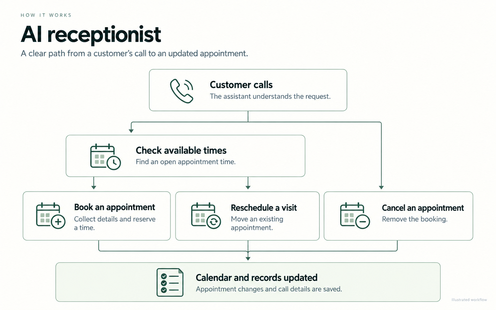
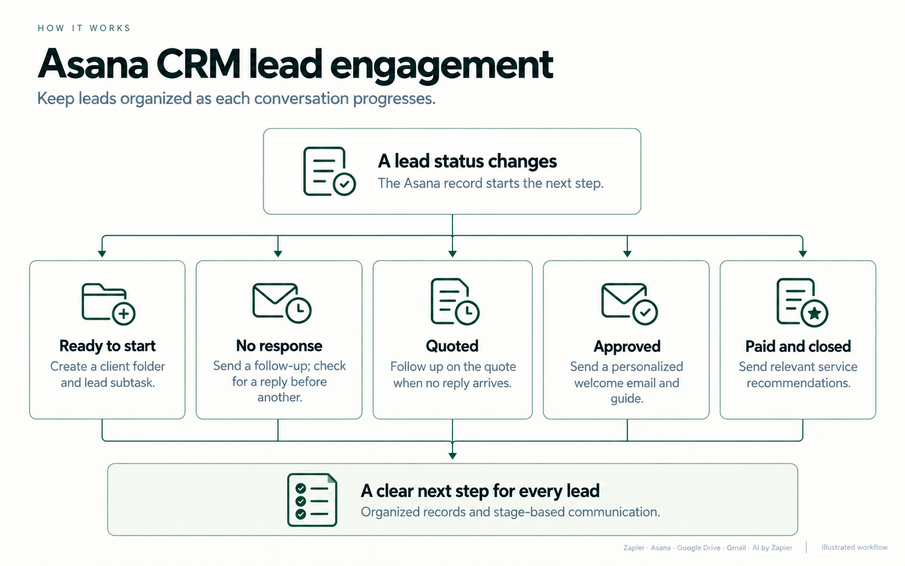
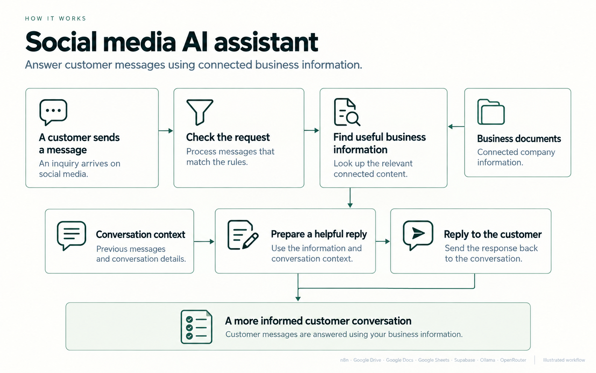
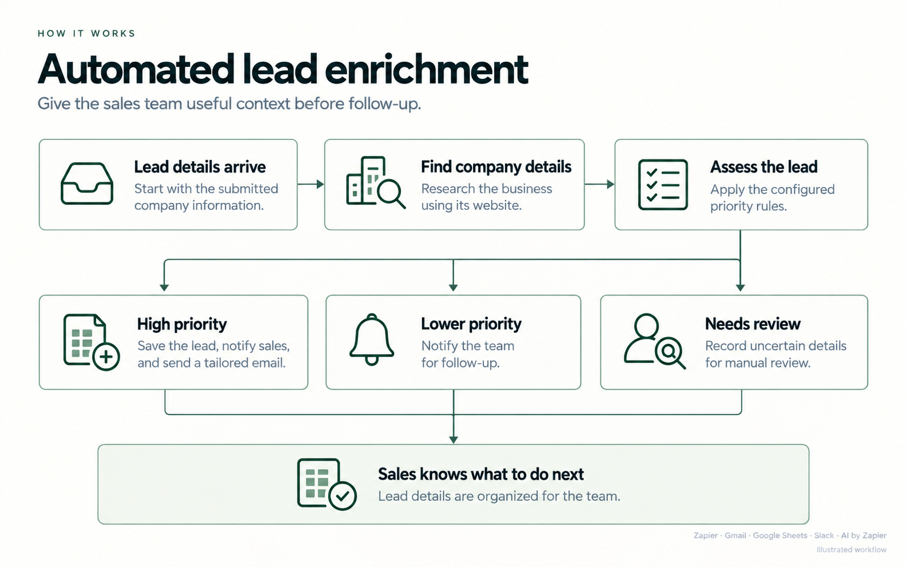
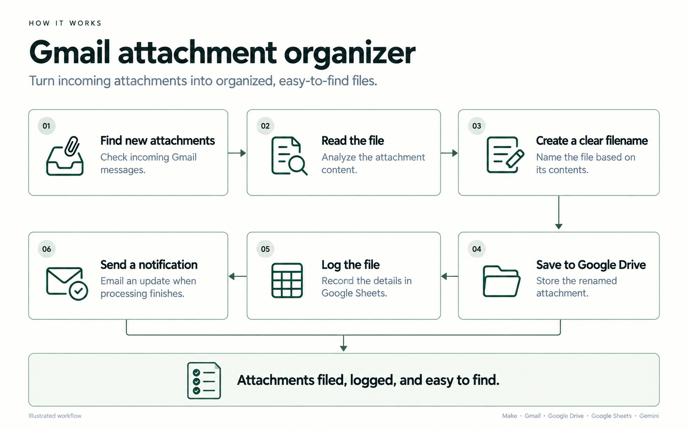
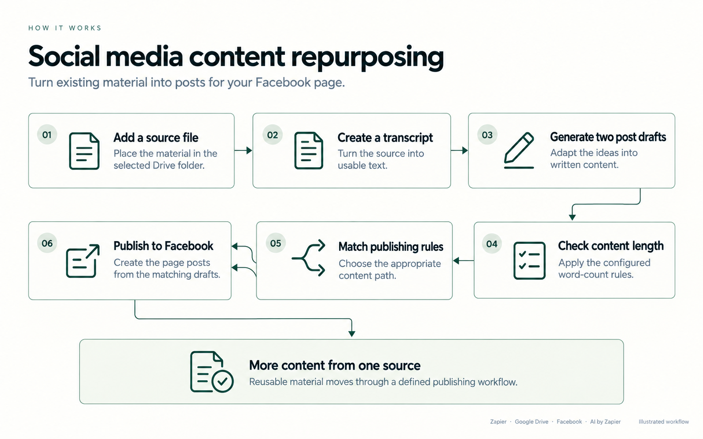
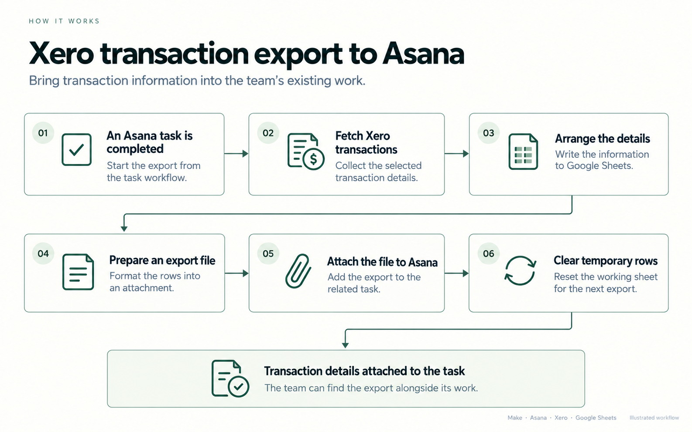
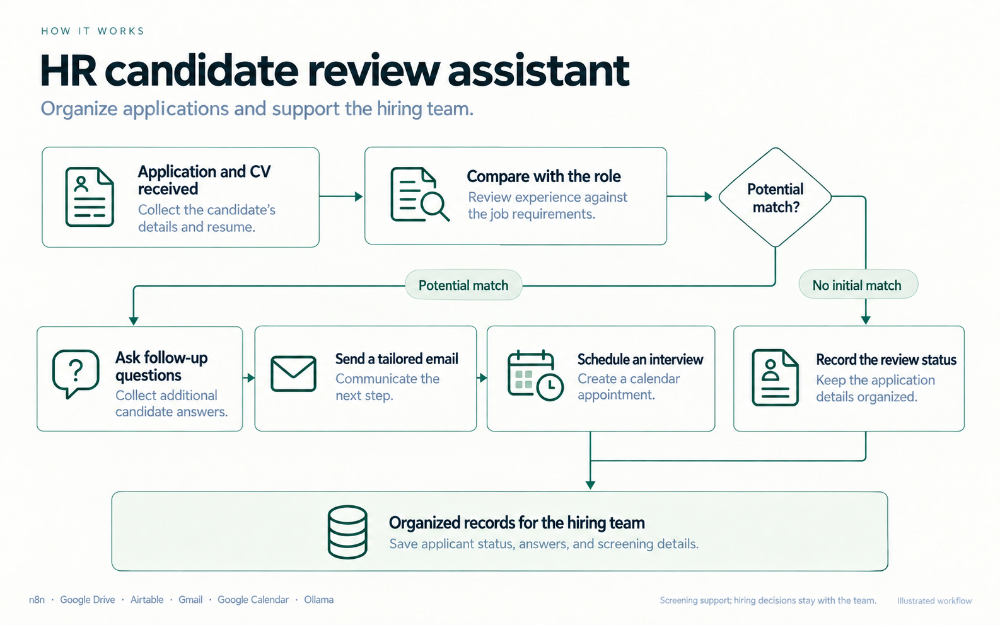
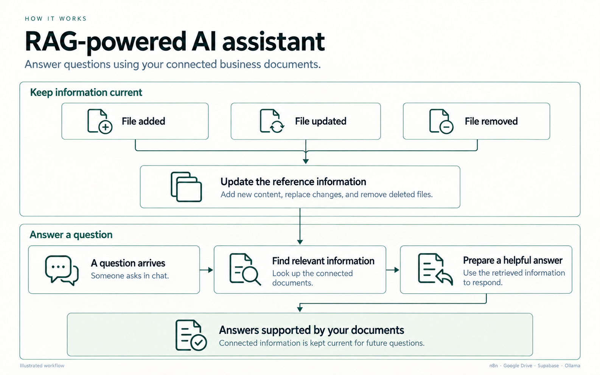

# Portfolio workflow illustrations

A matching set of client-friendly diagrams based on the supplied workflow screenshots. Open a PNG link to view or download the full-size illustration.

These are simplified explanations, not execution screenshots or measured results. The RAG-Powered AI Assistant is included separately because its screenshot and case study describe a distinct document-sync workflow.

| Project | Full-size illustration | Tools |
|---|---|---|
| AI Receptionist | [View / download](ai-receptionist-portfolio.png) | n8n, Vapi, Google Calendar |
| Asana CRM Lead Engagement | [View / download](asana-crm-lead-engagement-portfolio.png) | Zapier, Google Drive, Asana, Gmail, AI by Zapier |
| Social Media AI Agent with RAG | [View / download](social-media-ai-assistant-portfolio.png) | n8n, Google Drive, Google Sheets, Google Docs, Supabase, AI Agent, Ollama, OpenRouter |
| Automated Lead Enrichment | [View / download](automated-lead-enrichment-portfolio.png) | Zapier, Gmail, Google Sheets, Slack, AI by Zapier |
| Gmail Attachment Organizer | [View / download](gmail-attachment-organizer-portfolio.png) | Make, Gmail, Google Drive, Google Sheets, Gemini |
| Social Media Content Repurposing | [View / download](social-media-content-repurposing-portfolio.png) | Zapier, Google Drive, Facebook, AI by Zapier |
| Xero Transaction Export to Asana | [View / download](xero-transaction-export-to-asana-portfolio.png) | Make, Asana, Xero, Google Sheets |
| HR Job Posting and Candidate Review Assistant | [View / download](hr-candidate-review-assistant-portfolio.png) | n8n, Google Drive, Airtable, AI Agent, Gmail, Google Calendar, Ollama |
| RAG-Powered AI Assistant | [View / download](rag-powered-ai-assistant-portfolio.png) | n8n, Google Drive, Supabase, Ollama |

## Preview gallery

AI Receptionist

**Tools:** n8n, Vapi, Google Calendar

Asana CRM Lead Engagement

**Tools:** Zapier, Google Drive, Asana, Gmail, AI by Zapier

Social Media AI Agent with RAG

**Tools:** n8n, Google Drive, Google Sheets, Google Docs, Supabase, AI Agent, Ollama, OpenRouter

Automated Lead Enrichment

**Tools:** Zapier, Gmail, Google Sheets, Slack, AI by Zapier

Gmail Attachment Organizer

**Tools:** Make, Gmail, Google Drive, Google Sheets, Gemini

Social Media Content Repurposing

**Tools:** Zapier, Google Drive, Facebook, AI by Zapier

Xero Transaction Export to Asana

**Tools:** Make, Asana, Xero, Google Sheets

HR Job Posting and Candidate Review Assistant

**Tools:** n8n, Google Drive, Airtable, AI Agent, Gmail, Google Calendar, Ollama

RAG-Powered AI Assistant

**Tools:** n8n, Google Drive, Supabase, Ollama

The original AI Receptionist concept is preserved in `ai-receptionist-overview.png`. Use the `*-portfolio.png` files for the consistent portfolio set.
